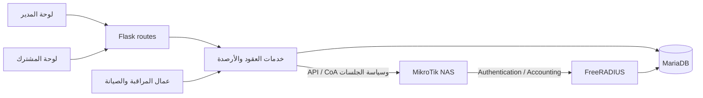

# بنية MAX RADIUS
أعيدت مراجعة حدود البنية مقابل HEAD في HANDOFF بتاريخ13أكتوبر2026. التشغيل الحالي في [ENVIRONMENTS](ENVIRONMENTS.md)، وليس هذا الرسم.

`web/__init__.py` ينشئ التطبيق ويسجل الحماية وBluePrints. `web/app.py` و`run.py` نقاط تشغيل، وليسا أدوات فهرسة بلا آثار جانبية. بعض العمال يبدأ عند إنشاء التطبيق، وآخرون في المشغّل؛ لذلك لا تنشئ تطبيقًا إضافيًا لمراقبة اختبار طويل.

تخزين الحسابات وعقودها في `wisp_*`، وإعدادات RADIUS في `radcheck/radreply/radusergroup/radgroupreply`، والمحاسبة في `radacct` والمصادقة المسجلة في `radpostauth`. خدمات الحسابات تزامن الصفات عبر `core/radius_sync.py`.

تدفق التجديد: مسار مدير أو مشترك ← خدمة مالية/عقد ← حماية وتسوية جلسات الحساب ← تحديث العقد والأرصدة وسجل البيع/الفاتورة ← مزامنة الحدود. تفاصيل الترتيب تختلف بين العمليات؛ تتبع الاستدعاءات الفعلية ولا تفترض أن كل المسارات تستخدم دالة واحدة.

Hotspot وPPPoE لهما عدادات وهوية جلسة وطرق تحكم مختلفة. قراءة قائمة الاتصال وحدها لا تثبت استهلاكًا نهائيًا. L2TP مسار وصول NAS في بعض النشرات، وتعطله منفصل عن تعطل الراديوس أو API.

MySQL هو الخلفية التشغيلية للراديوس. SQLite خلفية يختارها الإعداد صراحة للاستخدام المحلي/اختبارات محددة؛ لا يثبت اختبار SQLite سلامة الأقفال أو التريغرات على MariaDB.

اللوحة المركزية للدومينات منفصلة عن تطبيق المستأجر. التحكم المستضاف في Docker يمر عبر واجهة محدودة؛ ملفات `deploy/hosted-max` تخص التكامل ولا تمثل كامل كود اللوحة.

وقت العمليات يعتمد epoch المضيف؛ NTP داخل التطبيق تشخيصي ولا يضيف offset. تبقى جلسات DB/RADIUS على +03:00، وتحول المناطق المحلية للعرض وتقويم الجداول الموجودة. انظر [الوقاية والحدود المختبرة](TIME_AND_STARTUP.md) قبل الخلط بين فحص NTP باللوحة ومزامنة kernel أو حاجز الإقلاع.
